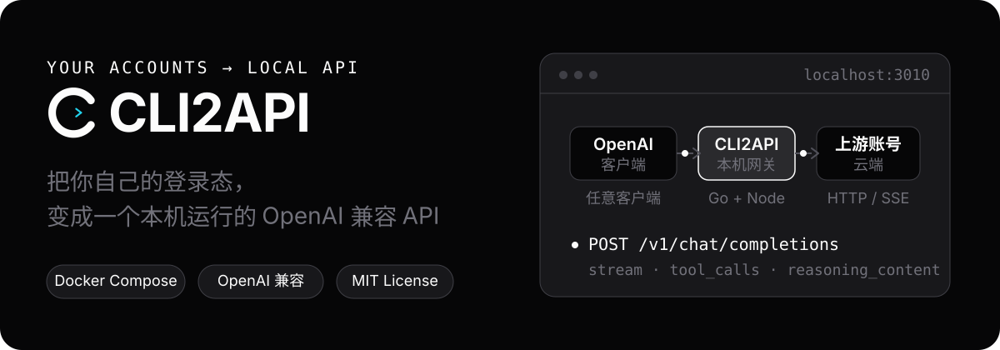

<div align="center">

<h1> CLI2API</h1>

**把你自己的登录态，变成一个本机 OpenAI 兼容 API**

接入 **Qoder（国际版 / 国内版）**、**WorkBuddy（国际版 / 国内版）**、**Trae 国内版 Work**、**ZCode（Z.ai）**、**小浣熊 Raccoon**、**Antigravity（Google）**，以及实验性的 **Devin** 和 **Command Code**。

用 Docker 部署，在 Web 控制台管理账号，再通过兼容 API 接入客户端。

[](LICENSE)
[](https://linux.do)

<sub>[English](README_EN.md) · [问题反馈](https://github.com/fengye102/cli2api/issues) · [LINUX DO](https://linux.do)</sub>



</div>

> **本仓库是 [caigee-cmd/cli2api](https://github.com/caigee-cmd/cli2api) 的 fork**：在上游基础上新增了 **ZCode（Z.ai）** 渠道（浏览器授权登录、凭证导入、计划通道验证码节点），并修好了几处凭证导入问题、补了一些控制台细节。完整清单见下方「与上游的差异」。

## 功能

- **兼容接口**：Chat Completions、Responses、Anthropic Messages 和模型列表，支持流式回复与函数工具调用。
- **多账号调度**：自动选号、会话粘性、并发限制、冷却与故障切换。
- **统一控制台**：管理账号、模型、客户端密钥、代理设置，查看额度和请求日志。
- **Docker 运维**：持久化账号数据；可选安装宿主机更新器，在控制台下载更新、确认升级和回滚。
- **ZCode（Z.ai）渠道**：浏览器授权登录（ZCode CLI 流程或粘贴回调链接）与凭证导入，对话走 Anthropic Messages 上游并翻译成 OpenAI 兼容响应（含工具调用与推理档位）。计划通道需要配套的验证码节点，见 [`deploy/captcha_node`](deploy/captcha_node/README.md)。

Qoder 国内版、WorkBuddy、Trae 的适配代码已实现，真账号验收仍未完成；Devin 与 Command Code 为实验性接入，不承诺生产可用。托管更新的真实升级 / 回滚验收也尚未完成。

## 快速开始

需要 Docker 和一个你自己控制的上游账号。macOS / Windows 使用 Docker Desktop；Windows 需使用 Linux containers。

```bash
git clone https://github.com/fengye102/cli2api.git
cd cli2api
./scripts/start.sh        # Windows 用 scripts\start.ps1
```

1. 保存首次启动日志中打印的**管理员密钥**。
2. 打开 `http://127.0.0.1:3010`，用管理员密钥登录，在 **Accounts** 添加账号。
3. 在 **API keys** 创建客户端密钥，在 **Access** 选择模型并测试。

Docker Compose 是支持的安装与托管更新路径；源码运行用于开发。详细步骤见 [部署说明](deploy/README.md)。

## 接入客户端

在支持 OpenAI 兼容 API 的客户端中填写：

```text
Base URL: http://127.0.0.1:3010/v1
API Key:  <在 API keys 页面创建的客户端密钥>
```

模型 ID 从 **Access** 页面或 `/v1/models` 获取。默认自动选择账号，同一对话优先复用原账号。固定账号、自定义会话标识及 curl / PowerShell 示例见 [部署说明](deploy/README.md)。

## 工作方式

<p align="center">
  
</p>

Go 网关统一鉴权、调度和记录请求。Qoder 每个账号使用独立 Node 进程与 HOME；WorkBuddy、Trae、ZCode、Devin、Command Code 使用 Go 进程内适配器，不为每次请求启动完整 CLI。

## 控制台

<p align="center">
  
</p>

账号、模型、接入和日志都在同一个 Web 控制台里管理：就绪状态和额度一目了然，Access 页可以直接复制 Base URL 并做一次快速验证。

在「账号」卡片直接操作 WorkBuddy 与 Qoder 国内版、国际版的签到、自动签到开关（默认关闭），并从「更多 → 签到记录」查看历史，不另设签到中心。在「系统 → 自动签到」配置各供应商默认时间，「编辑账号」可选择跟随默认或自定义；修改默认时间会立即影响未覆盖的账号。已有 WorkBuddy 账号保留原时间，可在编辑账号时切回跟随默认。活动关闭时只记录跳过；真实账号签到验收仍待完成。

## 使用限制

- 只连接你自己的账号，不提供账号、额度或官方 API 服务。
- 兼容接口不等于完整复刻官方 API。Messages / Responses 为无状态适配，不保存服务端会话，也不执行上游专属工具。
- 图片能力取决于上游和模型；WorkBuddy / Trae 不支持图片，文件输入会明确拒绝。具体范围见 [部署说明](deploy/README.md)。
- 跨上游同名模型调度受系统开关、账号权限和地域约束；不是任意账号之间都能切换。
- 上游协议变化可能影响兼容性；请求日志默认不保存提示词或回复正文。

## 与上游的差异

本 fork 在上游 [caigee-cmd/cli2api](https://github.com/caigee-cmd/cli2api) 的基础上增加了：

- **ZCode（Z.ai）渠道**：用 ZCode 客户端（Z.ai 的 Coding Plan）的登录态接入 GLM 系列模型。
  - 登录与导入：浏览器授权（走 ZCode CLI 那套登录流程，或退回粘贴回调链接）、粘贴 API Key（PAT），以及多种凭证导入格式 —— ZCode 凭证包、官方客户端 `~/.zcode/**/config.json` 里的明文 `apiKey`、`credentials.json`、裸 API Key / JWT；机器绑定的 `enc:v1:` 密文会被拒绝并给出可操作提示。
  - 对话走 Anthropic Messages 上游，翻译成 OpenAI 兼容的流式 / 非流式响应，覆盖工具调用与 thinking 块对应的 `reasoning_content`；推理档位由模型 catalog 驱动。
  - **计划通道需要验证码节点**：该通道要求每个请求带新鲜的阿里云无痕验证参数，所以要把 `deploy/captcha_node`（Chromium + 目录内 `npm install`）部署好，并用 `ZCODE_CAPTCHA_DIR` / `ZCODE_CHROMIUM_PATH` 指过去；没有它，计划通道的对话会被上游以 3012 拒绝。
  - 只保留 **Z.ai** 一个服务（BigModel 国内版已移除）。
- **凭证导入修复**：多个候选字段按字段优先级确定性解析（此前依赖 map 迭代顺序，同一份内容会随机选中不同账号且不报错）；保留 token 自身含 `+` 的 `uid+token` 拼接形式；`{account, auth}` 这类嵌套导出结构只有在确实带 access token 时才按该结构解析。
- **控制台细节**：zcode 账号显示 `ZCode Z.ai` 与官方图标；API 访问页给 Anthropic 兼容端点单独一张**根地址** Base URL 卡片（Anthropic 客户端自己会拼 `/v1/messages`，填带 `/v1` 的地址会变成 `/v1/v1/messages`）；系统设置在 fork / 开发版构建下也会列出官方版本历史。
- **WorkBuddy 额外模型**：用 `WORKBUDDY_EXTRA_MODELS` 注入不在 Grayscale 目录里的模型（默认已注入 `deepseek-v4.1-flash`，见 `deploy/docker-compose.yml`）。
- **小浣熊 Raccoon 渠道**：导入 Raccoon（商汤）网页端的 access/refresh token 对即用，OpenAI 兼容对话、远程 `model_catalog` 目录刷新、401 自动刷新重试。
- **Antigravity 渠道**：粘贴 Gemini API Key（Google AI Studio）即用，走 Google Gemini 的 OpenAI 兼容层（`/v1beta/openai`），gemini-* 模型带推理档位。
- **ZCode Start-Plan 每日领取**：控制台账号操作新增 `claim` / `claim/preview`，可每日领取 ZCode 限时体验套餐（Trust Build 等），复用了计划网关的 preview/claim 协议与验证码节点。

除以上差异外，功能与部署方式与上游一致，上游文档与更新说明仍然适用。

## 文档

- [部署与运维：启动步骤、环境变量、接口、托管更新](deploy/README.md)
- [变更记录](CHANGELOG.md)

## 安全

默认只向本机开放 `127.0.0.1:3010`，不要直接暴露到公网。管理员密钥可操作控制台；客户端密钥仅用于 `/v1/*`。请妥善保管密钥、账号导出文件和数据库备份，发现问题按 [SECURITY.md](SECURITY.md) 私下报告。

## 社区与贡献

中文讨论见 [LINUX DO](https://linux.do)。缺陷和功能请求请走 GitHub [Issue](https://github.com/fengye102/cli2api/issues)；文档改进与 Pull Request 见 [CONTRIBUTING.md](CONTRIBUTING.md)。

## 致谢

感谢 `workbuddy2api`、`CLIProxyAPI`、`sub2api` 等开源项目提供的思路与启发。

## 许可证

[MIT](LICENSE)。使用上游账号时，请遵守对应平台的服务条款。
