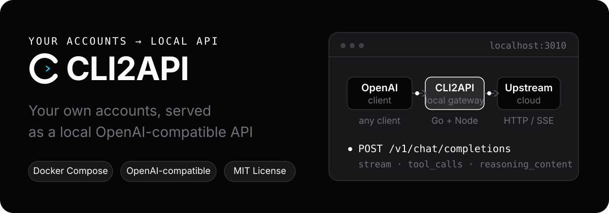
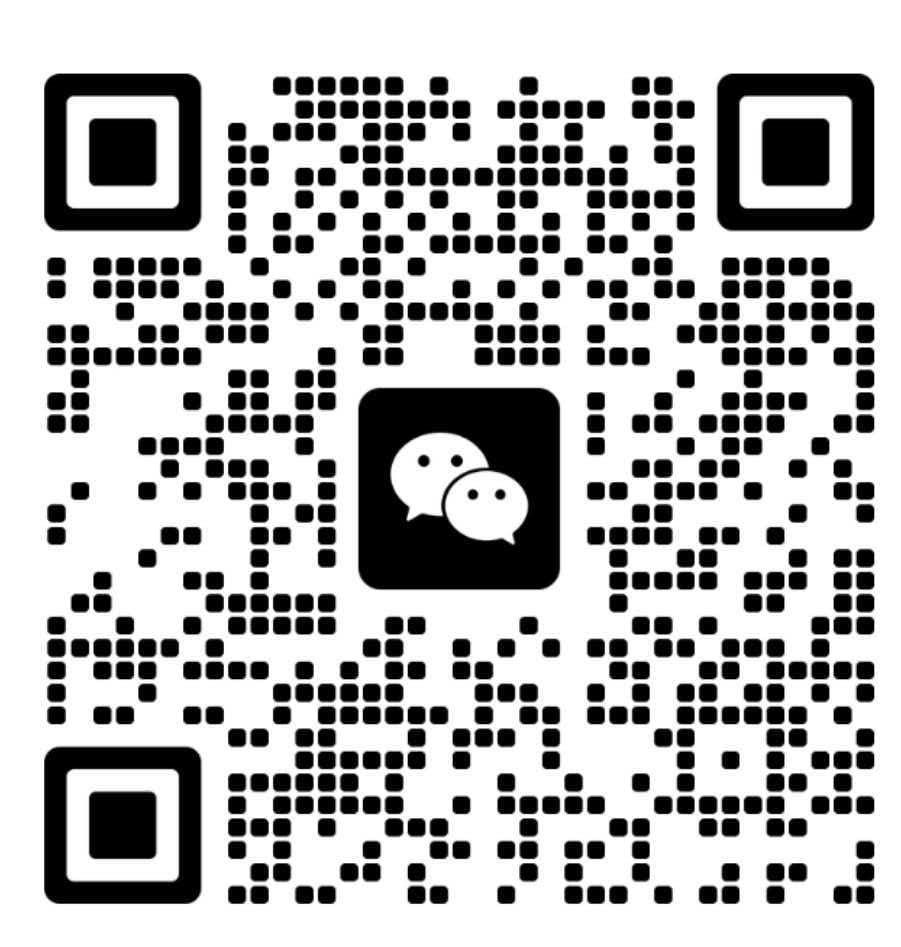

<div align="center">

<h1> CLI2API</h1>

**Turn your own logins into a local OpenAI-compatible API**

Connect **Qoder (Global / CN)**, **WorkBuddy (Global / CN)**, **Trae CN Work**, and experimental **Devin** and **Command Code** accounts.

Deploy with Docker, manage accounts in the web console, and connect clients through compatible APIs.

[](LICENSE)
[](https://t.me/+jCjL8ou_g7Q2MzI1)

<sub>[中文](README.md) · [Issues](https://github.com/fengye102/cli2api/issues) · [Telegram](https://t.me/+jCjL8ou_g7Q2MzI1)</sub>



</div>

## Features

- **Compatible APIs**: Chat Completions, Responses, Anthropic Messages, and model listing, with streaming and function tools.
- **Multi-account routing**: automatic selection, session affinity, concurrency limits, cooldowns, and failover.
- **Web console**: manage accounts, models, client keys, and proxies; view quotas and request logs.
- **Docker operations**: persistent account data; an optional host updater lets you download, confirm, and roll back updates from the console.

Qoder CN, WorkBuddy, and Trae adapters are implemented, but live-account acceptance is still pending. Devin and Command Code are experimental, not production-ready. Live upgrade and rollback acceptance is also pending.

## Quick start

You need Docker and an upstream account you control. Use Docker Desktop on macOS / Windows; Windows must use Linux containers.

```bash
git clone https://github.com/caigee-cmd/cli2api.git
cd cli2api
./scripts/start.sh        # Windows: scripts\start.ps1
```

1. Save the **administrator key** printed in the first-start logs.
2. Open `http://127.0.0.1:3010`, sign in with that key, and add an account in **Accounts**.
3. Create a client key in **API keys**, then choose a model and test it in **Access**.

Docker Compose is the supported install and managed-update path; source runs are for development. See the [deployment guide](deploy/README.md).

## Connect a client

In an OpenAI-compatible client, enter:

```text
Base URL: http://127.0.0.1:3010/v1
API Key:  <a client key created in API keys>
```

Get a model ID from **Access** or `/v1/models`. Routing is automatic and prefers the same account for later turns. Account pinning, session headers, and curl / PowerShell examples are in the [deployment guide](deploy/README.md).

## How it works

<p align="center">
  
</p>

The Go gateway handles authentication, routing, and request logging. Each Qoder account has its own Node process and HOME; WorkBuddy, Trae, Devin, and Command Code use Go in-process adapters. No full CLI is started per request.

## Console

<p align="center">
  
</p>

Accounts, models, access, and logs all live in one web console: readiness and quota are visible at a glance, and the Access page lets you copy the Base URL and run a quick check.

Account cards provide WorkBuddy, QwenWork CN/Global, Qoder CN, and Qoder Global check-in actions and automatic check-in switches (off by default), with history under More → Check-in records; no separate check-in page is needed. Set each provider's default time under System → Automatic check-in, then choose inheritance or an override in Edit account. Default changes apply to inheriting accounts immediately. Existing WorkBuddy accounts retain their previous times until switched to inheritance. Inactive campaigns are skipped. Live-account check-in acceptance is still pending. QwenWork ships a check-in API in its desktop client, but production gateways do not route it (404): CN confirms the daily free credits from the wallet balance, while Global can only report the total quota and the skip reason.

## Limitations

- Bring your own accounts. CLI2API does not supply accounts, quotas, or an official API service.
- Compatibility is not full API parity. Messages / Responses are stateless adapters, without server-side conversations or upstream-specific tool execution.
- Image support depends on the upstream and model. The gateway surfaces each model's declared image input as `supports_images` on `/v1/models` and `/api/models`. WorkBuddy's DeepSeek V4 / V4.1, GLM, and Kimi models accept images; Trae, Command, and Zhipu do not declare image input. See the [deployment guide](deploy/README.md) for details.
- Cross-provider routing for shared model IDs follows system settings, key grants, and region constraints; failover is not unrestricted.
- Upstream changes can break compatibility. Request logs do not store prompt or completion bodies by default.

## Differences from upstream

This repository is a fork of [caigee-cmd/cli2api](https://github.com/caigee-cmd/cli2api) and adds:

- **ZCode (Z.ai) channel**: use a ZCode client login (Z.ai Coding Plan) to reach the GLM family.
  - Login and import: browser sign-in (the ZCode CLI flow, or a pasted callback URL as fallback), a pasted API key (PAT), and several credential import shapes — a ZCode credential bundle, the plaintext `apiKey` in the official client's `~/.zcode/**/config.json`, a `credentials.json` document, or a bare API key / JWT. Machine-bound `enc:v1:` values are rejected with an actionable message.
  - Chat runs against the Anthropic Messages upstream and is translated to OpenAI-compatible streaming and non-streaming responses, including tool calls and `reasoning_content` for thinking blocks; reasoning levels are catalog-driven.
  - **The plan channel needs the verification solver**: it rejects a request without a fresh Aliyun verification token, so deploy `deploy/captcha_node` (Chromium plus `npm install` in that directory) and point `ZCODE_CAPTCHA_DIR` / `ZCODE_CHROMIUM_PATH` at it. Without it, plan-channel chat is rejected upstream with code 3012.
  - Requests follow the client's **three-block system contract** (the caller prompt is appended to the end of the third block), byte-identical to the official desktop client. Editing that text breaks the contract.
  - Only **Z.ai** is supported (the BigModel region is gone).
- **Raccoon (SenseTime) channel**: paste the web client's access/refresh token pair and go — OpenAI-compatible chat, remote `model_catalog` refresh, automatic 401 refresh, plus daily check-in (Asia/Shanghai day boundary) and quota fetching.
- **Antigravity channel**: both credential shapes are supported — ① **browser login**: authorize with a Google account (authorization code plus a loopback callback on the gateway's own `/oauth-callback`, or paste the callback URL) and speak the Antigravity IDE protocol **Cloud Code Assist (`v1internal`)**: `streamGenerateContent` streaming, `fetchAvailableModels` catalog, `loadCodeAssist`/`onboardUser` project discovery, and automatic refresh on expiry or 401; ② **paste a Gemini API key** (Google AI Studio) to use Gemini's OpenAI-compatible layer (`/v1beta/openai`). Both modes expose reasoning levels for gemini-* models. Google geo-restricts this service, so `antigravity_region_egress` can route through a supported region.
- **ZCode Start-Plan daily claim**: the console account actions gain `claim` / `claim/preview` to claim ZCode's time-limited plans (Trust Build and friends) each day, reusing the plan gateway's preview/claim protocol and the verification solver.
- **Credential import fixes**: candidate fields are resolved in a deterministic, caller-defined priority order (previously map iteration order could silently pick a different account from the same paste), `uid+token` values keep the `+` inside the token, and `{account, auth}`-style nested exports are only parsed that way when they really carry an access token.
- **Console details**: zcode accounts show `ZCode Z.ai` and the vendor mark; the API access page gives the Anthropic-compatible endpoint its own origin-only base URL card (Anthropic clients append `/v1/messages` themselves, so a `/v1`-suffixed base becomes `/v1/v1/messages`); and system settings list the official version history even on a fork or development build.
- **Extra WorkBuddy models**: inject models outside the Grayscale catalog with `WORKBUDDY_EXTRA_MODELS` (the default injects `deepseek-v4.1-flash`, see `deploy/docker-compose.yml`).

Synced to upstream **v0.7.9**: inline `role: "system"` in `/v1/messages` (the shape Claude Code 2.1.293+ sends), first-byte-timeout failover, region-qualified prefixes (`workbuddy-cn/` and friends), the QwenWork channel, configurable request-log retention, and the Usage page Cost tab.

Everything else behaves and deploys like upstream; the upstream documentation and release notes still apply.

## Documentation

- [Deployment and operations: setup steps, environment variables, endpoints, managed updates](deploy/README.md)
- [Changelog](CHANGELOG.md)

## Security

The default deployment exposes only `127.0.0.1:3010`; do not expose it directly to the public internet. Administrator keys manage the console; client keys only access `/v1/*`. Protect keys, credential exports, and database backups. Report security issues privately as described in [SECURITY.md](SECURITY.md).

## Community & Contributing

Discussion is in the [Telegram group](https://t.me/+jCjL8ou_g7Q2MzI1). In China you can also scan the personal WeChat QR below. Bugs and feature requests go to GitHub [Issues](https://github.com/fengye102/cli2api/issues); documentation improvements and pull requests are welcome — see [CONTRIBUTING.md](CONTRIBUTING.md).

<p align="center">
  
</p>

## Acknowledgements

Thanks to open-source projects including `workbuddy2api`, `CLIProxyAPI`, and `sub2api` for ideas and inspiration.

## License

[MIT](LICENSE). Follow each upstream platform's terms when using its accounts.
